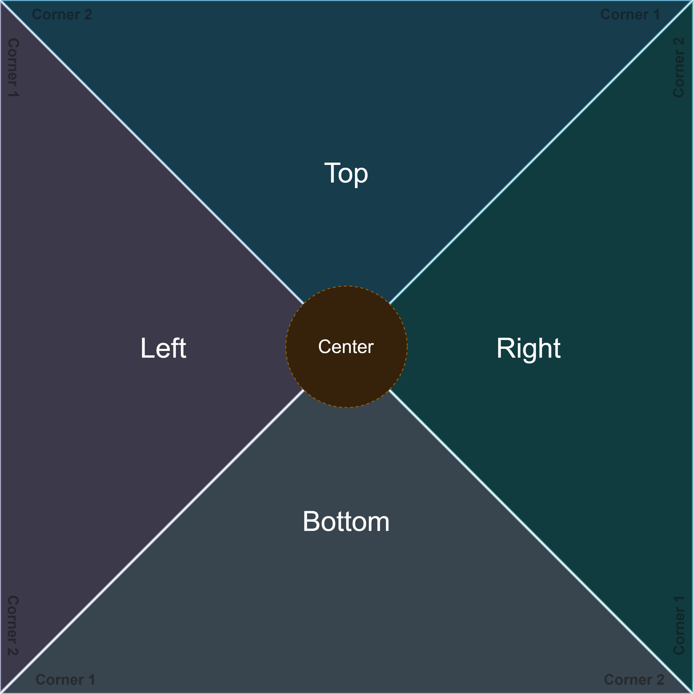

PBC (Physical Block Collision) files describe a grid of collision surfaces in **Animal Crossing: New Horizons**. Each grid cell contains four triangles, with vertex heights and a material ID for each triangle.

These files are often packaged inside model archives as `*_pbc.Nin_NX_NVN.zs`. The `.zs` wrapper is Zstandard-compressed; decompress it and extract the `.pbc` entry from the SARC archive before reading the structure below.

:::tip[How to edit?]
[Heaven Tool](/tools/heaven-tool) includes a PBC editor with collision and height previews. Collision view displays material IDs; HeightMap view displays the interpolated triangle surfaces. Individual vertex heights are available in the Inspector.
:::

## Structure

All multi-byte numbers are **little-endian**. Heights are IEEE 754 `float32` values. Offsets in the [header](#header) table are relative to the beginning of the extracted PBC file; offsets in the [cell](#cell-structure) and [triangle](#triangle-heights) tables are relative to their respective records.

### Header

The header is `0x14` (20) bytes long.

| Offset | Size | Type | Description |
| ------ | ---- | ---- | ----------- |
| `0x00` | 4 | byte[4] | Magic: `70 62 63 00` (`pbc` followed by a null byte) |
| `0x04` | 4 | int32 | Grid width, in cells |
| `0x08` | 4 | int32 | Grid height, in cells |
| `0x0C` | 4 | int32 | X placement offset, in cells |
| `0x10` | 4 | int32 | Z placement offset, in cells |

Placement offsets are signed and can be negative. They locate the grid when it is applied to the world; they do not change the order of the cell records. Some placement paths ignore these offsets, while others apply them. The game can also rotate the grid and add a placement height to its vertex heights.

### Cell array

Cells begin immediately after the header and are stored in **row-major order**, with X changing fastest:

```text
cellIndex = x + width * z
cellOffset = 0x14 + cellIndex * 0x34
```

Each cell occupies `0x34` (52) bytes, so the expected extracted file size is:

```text
fileSize = 0x14 + width * height * 0x34
```

The width and height count whole cells, not triangles or individual height samples. The analyzed game code uses a cell side length of **5.0 world units**.

### Cell structure

The four height records are followed by the four material bytes. Heights and materials are **not** interleaved.

| Offset | Size | Type | Description |
| ------ | ---- | ---- | ----------- |
| `0x00` | 12 | float32[3] | Top triangle heights |
| `0x0C` | 12 | float32[3] | Left triangle heights |
| `0x18` | 12 | float32[3] | Bottom triangle heights |
| `0x24` | 12 | float32[3] | Right triangle heights |
| `0x30` | 1 | uint8 | Top triangle material ID |
| `0x31` | 1 | uint8 | Left triangle material ID |
| `0x32` | 1 | uint8 | Bottom triangle material ID |
| `0x33` | 1 | uint8 | Right triangle material ID |

## Triangle geometry

A cell is divided along its diagonals into four triangles meeting at the center. This diagram looks down onto the X/Z plane, with X to the right and Z downward:




### Triangle heights

Each triangle stores the heights of **three vertices**, in this order:

| Offset | Size | Type | Description |
| ------ | ---- | ---- | ----------- |
| `0x00` | 4 | float32 | Center height |
| `0x04` | 4 | float32 | Corner 1 height |
| `0x08` | 4 | float32 | Corner 2 height |

The corner positions depend on the triangle:

| Triangle | Center | Corner 1 | Corner 2 |
| -------- | ------ | -------- | -------- |
| Top | Cell center | Top-right | Top-left |
| Left | Cell center | Top-left | Bottom-left |
| Bottom | Cell center | Bottom-left | Bottom-right |
| Right | Cell center | Bottom-right | Top-right |

The game uses the three vertex heights to construct a plane and evaluate the surface height at a point. Equal heights produce a flat triangle; differing heights produce a slope. At the triangle's centroid, the interpolated height is the mean of the three vertex heights.

Each triangle stores its own copy of the center and corner heights. Shared positions are not stored as a single shared vertex. To keep a surface continuous when editing, update the copies along adjoining edges consistently; differing copies can create height discontinuities.

### Choosing a triangle

For normalized coordinates within a cell (`0` to `1`), the game selects a triangle using both diagonals:

| Condition | Triangle |
| --------- | -------- |
| `z < x` and `x + z < 1` | Top |
| `z >= x` and `x + z < 1` | Left |
| `z >= x` and `x + z >= 1` | Bottom |
| `z < x` and `x + z >= 1` | Right |

These conditions also specify which triangle is selected exactly on a diagonal. In particular, the cell center selects the bottom triangle.

## Material IDs

Material names and ground attributes are defined in **`Bcsv/ColGroundAttributeParam.bcsv`**. The PBC material byte selects a row in this file, starting at row 0.

The Japanese names below come from its `DebugName string32` field. The English descriptions are translations of those names.

### Complete list

| PBC ID | Japanese name | English description |
| ------ | ------------- | ------------------- |
| 0 | 草 | Grass |
| 1 | 川 | River |
| 2 | 土(固い) | Soil (hard) |
| 3 | 石 | Stone |
| 4 | 砂浜 | Sandy beach |
| 5 | 海 | Sea |
| 6 | 木(分厚い) | Wood (thick) |
| 7 | Null | Null |
| 8 | 建物 | Building |
| 9 | 編集不可 | Editing prohibited |
| 10 | ドア０ | Door 0 |
| 11 | カメラ | Camera |
| 12 | 汽水地 | Brackish water |
| 13 | 替床 | Replacement floor |
| 14 | 踊り場 | Landing |
| 15 | 造成不可 | Terraforming prohibited |
| 16 | 土(柔らかい) | Soil (soft) |
| 17 | 大理石 | Marble |
| 18 | コーティング床 | Coated floor |
| 19 | 砂利 | Gravel |
| 20 | 落ち葉 | Fallen leaves |
| 21 | 雪 | Snow |
| 22 | 木(薄い) | Wood (thin) |
| 23 | じゅうたん | Carpet |
| 24 | たたみ | Tatami |
| 25 | 鉄 | Iron |
| 26 | 道:つち | Path: dirt |
| 27 | 道:石畳 | Path: stone paving |
| 28 | 欄干 | Railing |
| 29 | 波打ち際 | Shoreline / water's edge |
| 30 | ラグ専用 | Rug only |
| 31 | 道:濃い色のつち | Path: dark dirt |
| 32 | 道：砂 | Path: sand |
| 33 | 道:レンガ | Path: brick |
| 34 | 道:木 | Path: wood |
| 35 | 道:タイル | Path: tile |
| 36 | 道:扇状石畳 | Path: fan-shaped stone paving |
| 37 | 進入不可 | Entry prohibited |
| 38 | スポンジマット | Sponge mat |
| 39 | ビニールシート | Vinyl sheet |
| 40 | マイデザイン床 | Custom-design floor |
| 41 | 岩場 | Rocky ground |
| 42 | 岩場進入不可 | Rocky ground: entry prohibited |
| 43 | 岩場水たまり | Rocky-ground puddle |
| 44 | 砂岩 | Sandstone |
| 45 | 桟橋 | Pier |
| 46 | 波打ち際進入不可 | Shoreline: entry prohibited |
| 47 | 草が生えない建物 | Building without grass growth |
| 48 | 屋内:草 | Indoor grass |
| 49 | 草が生えない編集不可 | Editing prohibited, without grass growth |
| 50 | 泥沼 | Mud / swamp |
| 51 | 石生成草 | Grass for rock generation |
| 52 | マイデザイン屋外 | Outdoor custom design |
| 53 | 水たまり(土) | Puddle (soil) |
| 54 | 博物館水面 | Museum water surface |
| 55 | 右回転禁止 | Right rotation prohibited |
| 56 | 左回転禁止 | Left rotation prohibited |
| 57 | 回転禁止 | Rotation prohibited |
| 58 | 土(固い)進入禁止 | Hard soil: entry prohibited |
| 59 | 砂浜進入禁止 | Sandy beach: entry prohibited |
| 60 | 水(砂) | Water (sand) |
| 61 | 水(砂利) | Water (gravel) |
| 62 | 溶岩 | Lava |
| 63 | 屋内:砂 | Indoor sand |
| 64 | 海進入禁止 | Sea: entry prohibited |
| 65 | ゆめみ室内専用 | Luna: indoor only |
| 66 | 盛り土 | Earth mound / embankment |
| 67 | カスタム0 | Custom 0 |
| 68 | カスタム1 | Custom 1 |
| 69 | カスタム2 | Custom 2 |
| 70 | 砂浜(足跡無) | Sandy beach (no footprints) |
| 71 | カスタム3 | Custom 3 |
| 72 | インク | Ink |

### Ground-attribute flags

The same BCSV file includes the following boolean fields. These are **parameter values**, not a complete simulation of collision or placement: the game also considers overlays, structures, position, and other conditions.

| Field | Meaning of the parameter |
| ----- | ------------------------ |
| `CanBury u8` | Burying flag |
| `FtrPlace u8` | Furniture-placement flag |
| `NpcNoEntry u8` | NPC entry-prohibition flag |
| `PlayerNoEntry u8` | Player entry-prohibition flag |
| `Sand u8` | Sand flag |
| `WaterCheck u8` | Water-check flag |

These fields use 0 for false and 1 for true. The file also provides effect and sound attributes, a display sort ID, and additional fields whose full meanings are not documented here.

### Material behavior

When applying a PBC to the world collision grid, the game can skip or remap material IDs. One base-placement path skips materials 7 (Null), 11 (Camera), and 15 (terraforming prohibited), and remaps material 64 (sea: entry prohibited) to 5 (sea).

Some special-case behavior remains incompletely understood, including replacement floor, landing, the four custom entries, and Ink. Their names describe the records, but do not establish all runtime effects.
